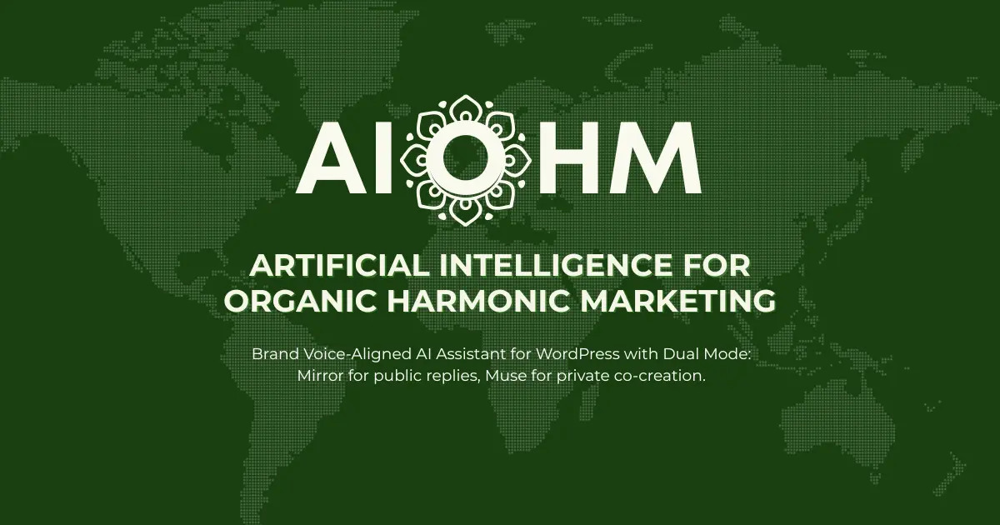
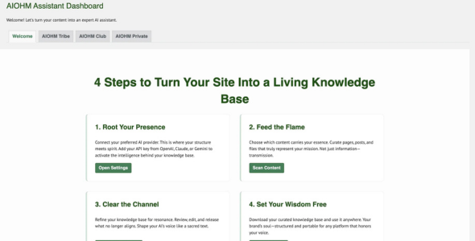
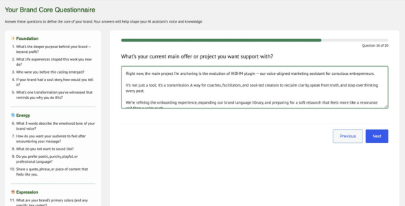
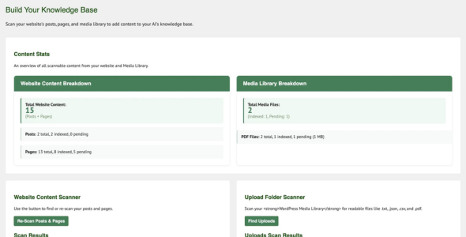
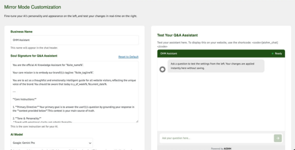

# AIOHM Knowledge Assistant — Your Brand Voice, Your AI

[](https://wordpress.org/)
[](https://php.net/)
[](https://www.gnu.org/licenses/gpl-2.0.html)

AIOHM Knowledge Assistant is a powerful, privacy-first, and **WordPress 7.0-ready** AI integration that transforms your WordPress site into an intelligent knowledge base. Train a custom public-facing chatbot directly on your posts, pages, and uploaded files so it answers visitor questions in your brand's authentic voice.

---



---

## 🚀 Why AIOHM Knowledge Assistant?

Most AI chatbots provide generic, robotic answers because they lack context and personality. AIOHM solves this by giving you:

* **Authentic Brand Voice**: A tailored questionnaire and personality system prompt that guides your AI to talk like your team.
* **Direct Content Indexing**: Scan and chunk your WordPress posts, pages, WooCommerce products, or uploaded files (PDF, CSV, TXT, JSON) to build a semantic database.
* **API Key Sovereignty**: You connect directly to your preferred AI providers. Your keys remain encrypted on your server, and you don't pay middleman markup fees.
* **WP 7.0 Connector Native**: Seamless integration with WordPress 7.0's new Connectors feature for easy API configuration.

---

## 📸 Inside the Dashboard

### 1. Main Control Center
Track your database health, usage stats, and active AI connections at a glance.


### 2. Tailor Your Brand Voice
Define your Soul Signature and tone rules so the AI communicates exactly how you want it to.


### 3. Build the Brain
Re-scan posts, pages, or uploaded documents to build your indexed knowledge base instantly.


### 4. Interactive Live Preview
Configure your public chatbot's visual colors, primary styles, and test its answers instantly on the settings page before saving.


---

## ✨ Features (Free vs. Pro)

| Feature | Free Version | PRO Version |
| :--- | :---: | :---: |
| **Public Chatbot (`[aiohm_chat]`)** | ✅ Included | ✅ Included |
| **Private Brand Assistant (`[aiohm_private_assistant]`)** | ✅ Included | ✅ Included |
| **Private/Sensitive Knowledge Bases** | ✅ Included | ✅ Included |
| **Semantic Search & Chunking** | ✅ Included | ✅ Included |
| **OpenAI, Gemini, Claude, Groq** | ✅ Included | ✅ Included |
| **WP 7.0 Connectors Support** | ✅ Included | ✅ Included |
| **Document Scanning (PDF, JSON, TXT, CSV)** | ✅ Included | ✅ Included |
| **Brand Voice Personality Soul Signature** | ✅ Included | ✅ Included |
| **Q&A Generator Shortcode** | ✅ Included | ✅ Included |
| **Search Shortcode (`[aiohm_search]`)** | ✅ Included | ✅ Included |
| **MCP (Model Context Protocol) Integration** | ❌ Upgrade | ✅ Included |
| **Ollama Local AI Processing (100% Offline)** | ❌ Upgrade | ✅ Included |
| **White Label Mode (Remove branding)** | ❌ Upgrade | ✅ Included |
| **Unlimited Agency Deployments** | ❌ Upgrade | ✅ Included |

---

## 🛠️ Installation & Getting Started

1. **Upload**: Clone or download this repository, and place it in your `/wp-content/plugins/aiohm-knowledge-assistant/` directory.
2. **Activate**: Go to the **Plugins** menu in WordPress and activate **AIOHM Knowledge Assistant**.
3. **Configure API**:
   - Go to **AIOHM > Settings**.
   - Input your API key (OpenAI, Gemini, Claude, Groq, or ShareAI) OR use the **WordPress 7.0 Connectors** settings to pair your API keys centrally.
4. **Scan Content**: Go to **AIOHM > Build KB** to scan your posts, pages, or media library files.
5. **Set Voice**: Complete the Brand Soul questionnaire to establish your AI's personality.
6. **Deploy**: Copy and paste the shortcodes onto any page or widget.

---

## 📋 Shortcodes

Deploy your assistant anywhere with easy-to-use shortcodes:

### 1. Public Chatbot
Add a customizable floating or embedded chatbot to any page:
```text
[aiohm_chat]
```

### 2. Knowledge Base Search
Add a high-speed semantic search bar that searches your indexed database:
```text
[aiohm_search]
```

### 3. Q&A Sample Generator
Help visitors discover what they can ask by showing dynamic Q&A samples:
```text
[aiohm_qa_generator button_text="Generate Sample Q&A"]
```

---

## 💻 Developer & System Requirements

* **WordPress**: 6.2 or higher (fully optimized for 7.0)
* **PHP**: 7.4 or higher
* **Required Extensions**: `mbstring`, `json`, `curl`
* **Optional Integrations**: Paid Memberships Pro (for user access restrictions)

---

## 🔒 Privacy & Compliance

All API keys are encrypted using secure WordPress hashing constants (`SECURE_AUTH_KEY` & `LOGGED_IN_KEY`) before database storage. When using external APIs, conversation content is routed over HTTPS to the selected provider. No data is stored externally on third-party middleware servers.

---

## 🏢 About OHM Events Agency

Developed and maintained by **[OHM Events Agency](https://www.ohm.events)**. We build digital tools that empower creators and agencies to build authentic, independent AI solutions.

For commercial licenses, custom white-label branding, or agency setups, visit [knowledge.aiohm.app](https://knowledge.aiohm.app/).
